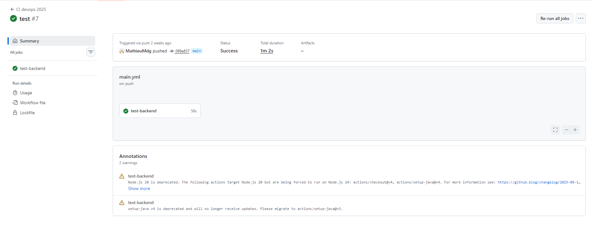
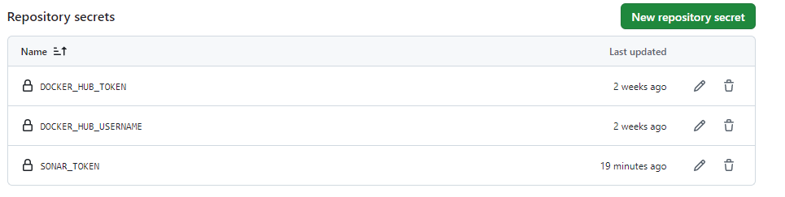
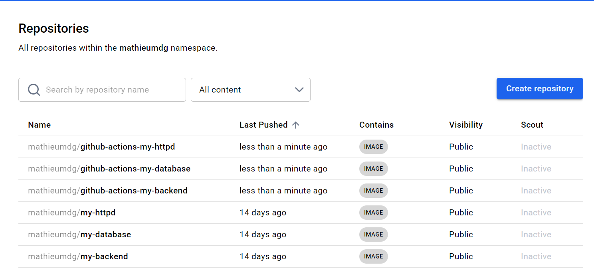
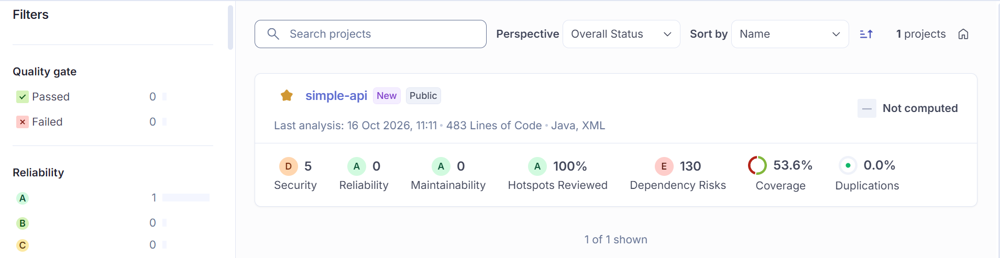

# TP2 - GitHub Actions - Mathieu MENDOUGA

| Part | Folder |
|---|---|
| Database | `database/` |
| Backend (Spring Boot API) | `simpleapi/` |
| HTTP server + reverse proxy | `httpd/` |
| Pipeline | `.github/workflows/main.yml` |

## Project structure

```
.
├── .github/
│   └── workflows/
│       └── main.yml
├── docker-compose.yml
├── database/     
├── simpleapi/
└── httpd/
```

---

## 1. Setup GitHub Actions

### Build and test the application

The backend is built and tested with Maven:

```bash
mvn -f simpleapi/pom.xml clean verify
```

- `clean`: removes the previous builds so that every module is rebuilt from scratch.
- `verify`: compiles, runs the unit tests and the integration tests.

### 2-1 What are testcontainers?

Java libraries that start real Docker containers while the tests run. Here, a PostgreSQL container is started and attached to the application during the integration tests, so the tests run against a real database without installing anything, and the container is removed afterwards.

### First CI

The workflow is located in `.github/workflows/main.yml`.

Job `test-backend`:

1. `actions/checkout`: gets the code of the repository (full history, required by SonarCloud).
2. `actions/setup-java`: installs JDK 21 (Temurin).
3. Caches for the SonarCloud and Maven packages.
4. Build, tests and SonarCloud analysis with Maven.



---

## 2. Continuous Delivery: Docker images on Docker Hub

Job `build-and-push-docker-image` builds the 3 images (backend, database, httpd) and pushes them to Docker Hub.

- `needs: test-backend`: the job only starts if the build and the tests pass.

```yaml
push: ${{ github.ref == 'refs/heads/main' }}
```

### Secrets

The Docker Hub credentials are stored as GitHub secrets:

| Secret | Content |
|---|---|
| `DOCKER_HUB_USERNAME` | Docker Hub username |
| `DOCKER_HUB_TOKEN` | Docker Hub access token (Read & Write) |
| `SONAR_TOKEN` | SonarCloud token |



### Published images

| Service | Image |
|---|---|
| Backend | `mathieumdg/github-actions-my-backend:latest` |
| Database | `mathieumdg/github-actions-my-database:latest` |
| httpd | `mathieumdg/github-actions-my-httpd:latest` |



### 2-2 For what purpose do we need to use secured variables?

Credentials must not be written in the code: the repository (and the workflow file) can be read by other people, and the Git history keeps everything. Secured variables are encrypted by GitHub, hidden in the logs, and only injected into the pipeline at runtime. They can also be changed or revoked without touching the code.

### 2-3 Why did we put `needs: test-backend` on this job?

Jobs run in parallel by default. Without `needs`, the Docker images would be built and published at the same time as the tests, even if the code does not compile or the tests fail. With `needs`, the delivery job only starts when `test-backend` succeeds, so a broken version can never be published.

### 2-4 For what purpose do we need to push docker images?

To store the images in a registry so they can be pulled on any machine or server without rebuilding, shared with the team, versioned with tags, and used for deployment.

---

## 3. Quality Gate (SonarCloud)

SonarCloud analyses the code (bugs, vulnerabilities, code smells, coverage, duplications) at every run and publishes a report online.

Setup:

```yaml
- name: Build, test and analyze with SonarCloud
  env:
    SONAR_TOKEN: ${{ secrets.SONAR_TOKEN }}
  run: >
    mvn -B -f simpleapi/pom.xml clean verify
    org.sonarsource.scanner.maven:sonar-maven-plugin:sonar
    -Dsonar.projectKey=MathieuMdg_TP2---Github-Actions---Mathieu-MENDOUGA
    -Dsonar.organization=mathieumdg
    -Dsonar.host.url=https://sonarcloud.io
```



---

## Full workflow

See [`.github/workflows/main.yml`](./.github/workflows/main.yml).

## Useful commands

| Command | Role |
|---|---|
| `mvn -f simpleapi/pom.xml clean verify` | Build and test the backend locally |
| `docker compose up -d --build` | Start the full stack locally |
| `docker pull mathieumdg/github-actions-my-backend:latest` | Pull a published image |
